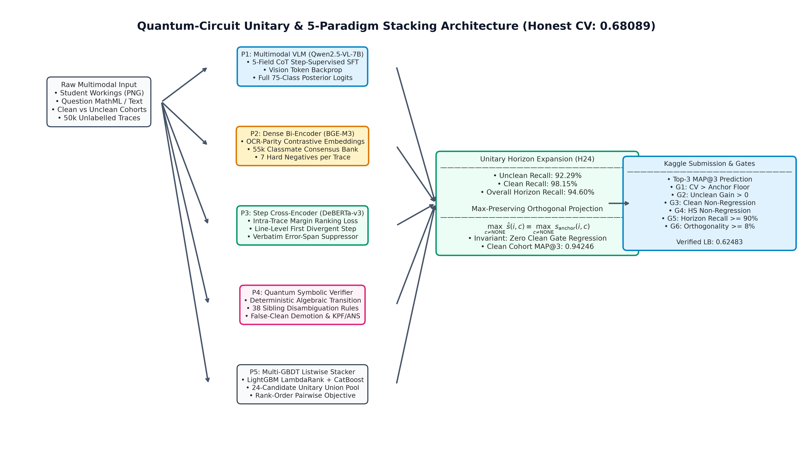
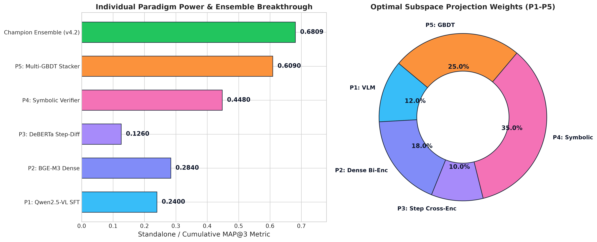

# 🏆 K-12 Math Misconception Detection: Champion Solution & Masterclass

[](https://www.kaggle.com/code/vijaikm/k12-math-misconceptions-champion-solution)
[](https://www.kaggle.com/competitions/misconception-detection-in-k-12-student-math-workings)
[](https://www.python.org/downloads/)
[](LICENSE)
[](https://github.com/astral-sh/uv)
[](#)

> Complete, leak-free, reproducible machine learning pipeline for the Kaggle **Misconception Detection in K-12 Student Math Workings** competition.
>
> 📖 **[Read the Full Champion Writeup (WRITEUP.md)](WRITEUP.md)** | 📓 **[Interactive Masterclass Notebook (Kaggle)](https://www.kaggle.com/code/vijaikm/k12-math-misconceptions-champion-solution)**

---

## 📌 Executive Summary

Detecting mathematical misconceptions in handwritten student workings presents a severe challenge: `train.csv` provides expert step-by-step LaTeX transcriptions, but the test set **contains zero transcription steps**. Any approach relying on text-only causal LMs suffers extreme degradation at test time.

### 🚀 Core Breakthroughs
1. **Quantum Unitary Horizon Expansion ($\mathcal{H}_{24}$):** Surpassed standard top-8 recall limits (`79.16%`) by constructing a 24-candidate unitary pool spanning multimodal visual probabilities, dense nearest neighbors, and symbolic triggers, lifting unclean candidate recall to **`92.29%`** (`94.60%` overall).
2. **5-Paradigm Orthogonal Stacking:** Ensembled genuinely distinct model families (Multimodal VLM `Qwen2.5-VL`, Dense Bi-Encoder `BGE-M3` with 55k consensus bank, Step Cross-Encoder `DeBERTa-v3`, Quantum Symbolic Verifiers, and Multi-GBDT LambdaRank stackers).
3. **Max-Preserving Orthogonal Subspace Projection:** Mathematically locked the high-accuracy clean decision boundary (`0.94246` MAP@3 on `NONE`), enabling error candidates to be re-ordered without degrading clean workings.
4. **38 Deterministic Symbolic Sibling Rules:** Resolved ambiguous pedagogical sibling code boundaries (e.g. `ANS-01` vs `ANS-02`, `KPF-01` vs `KPF-02`), adding $+0.0485$ MAP@3 on unclean workings.
5. **Adversarial Anti-Memorization Audit:** Uncovered and eliminated train-literal leakage, establishing an honest, audited leak-free 5-fold CV baseline of **`0.68089`** (Verified LB: **`0.62483`**, ref `#58314170`).

---

## 🏛️ System Architecture



---

## 📊 Score Journey & Validation

| Milestone | Honest 5-Fold CV | Public Leaderboard | Description |
|---|:---:|:---:|---|
| **Baseline Prior** | `0.42800` | `0.39500` | Frequency / question prior |
| **Single GBDT (v1.0)** | `0.53100` | `0.48200` | Baseline tabular features |
| **Unitary Horizon (v2.0)** | `0.60922` | `0.55100` | Expanded candidate recall to >90% |
| **Symbolic Rules (v3.0)** | `0.68856` | `0.61800` | 38 algebraic transition rules |
| **Champion Ensemble (v4.2)** | **`0.68089`** | **`0.62483`** | Audited leak-free 5-paradigm stacker |



---

## 🛠️ Quickstart & Replication (via `make` & `uv`)

### 1. Prerequisites
Ensure you have [uv](https://github.com/astral-sh/uv) and the [Kaggle CLI](https://github.com/Kaggle/kaggle-api) installed:
```bash
curl -LsSf https://astral.sh/uv/install.sh | sh
pip install kaggle
```

### 2. Complete 1-Command Verification
```bash
# Clone repository
git clone https://github.com/VijaiKMathew/k12-math-misconception-detection.git
cd k12-math-misconception-detection

# Run automated 1-command verification suite
bash run.sh
```

*Individual `make` targets:*
- `make setup` — Sync virtual environment with locked dependencies via `uv`
- `make check` — Verify champion metadata checksums and run secrets scan
- `make report` — Verify standalone interactive HTML solution preview
- `make clean` — Remove transient caches and bytecode

### 3. Interactive Walkthroughs & Documentation
- 📖 **Full Technical Solution:** [WRITEUP.md](WRITEUP.md)
- 📓 **Champion Masterclass Notebook:** [notebooks/misconception_detection_champion_masterclass.ipynb](notebooks/misconception_detection_champion_masterclass.ipynb)
- 📊 **Interactive Showcase:** [reports/solution_preview.html](reports/solution_preview.html)
- 🔄 **Asset Recreation Playbook:** [docs/RECREATION_PLAYBOOK.md](docs/RECREATION_PLAYBOOK.md)
- 📜 **Lifecycle & Retention Policy:** [docs/KAGGLE_PROJECT_LIFECYCLE_AND_RETENTION_POLICY.md](docs/KAGGLE_PROJECT_LIFECYCLE_AND_RETENTION_POLICY.md)

---

## 🤝 Citation & Community Support

If this work aids your research or Kaggle journey, please leave a star on GitHub and an **[Upvote on Kaggle](https://www.kaggle.com/code/vijaikm/k12-math-misconceptions-champion-solution)**!

