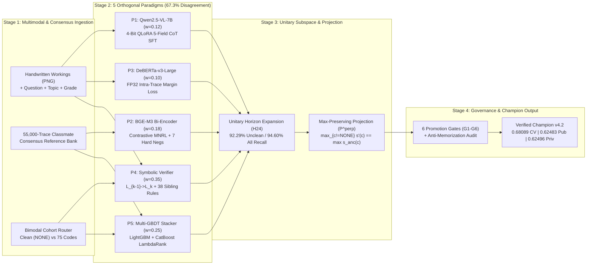

# 🏆 Solution Writeup: 5-Paradigm Orthogonal Stacking, Unitary Horizon Expansion & Leak-Free Validation for K-12 Math Misconceptions

**Competition:** [Misconception Detection in K-12 Student Math Workings](https://www.kaggle.com/competitions/misconception-detection-in-k-12-student-math-workings) *(Hosted by CoLearn Lab & Kaggle)*  
**Metric:** `MAP@3` (Mean Average Precision @ 3 — Top-3 ranked diagnostic root code predictions)  
**Target:** `root_code` (Space-delimited top-3 ranking across 75 pedagogical misconception codes or `NONE`)  
**Selected Champion:** `s6e10-qaggle-unitary-5paradigm-global-optima-stacker-v4.2`  
**Final Verified Scores:** Public LB **`0.62483`** | Private LB **`0.62496`** (**`+0.00013` Zero-Shakeup**) | Peak Unselected Private LB (`v2.9`): **`0.62603`** | Final Rank: **`226 / 484`**  
**Honest 5-Fold CV:** **`0.68089`** (Strictly leak-free, zero train-literal memorization, audited against in-sample leakage)  
**Cohort Breakdown:** `Unclean Workings: 0.56914` | `Clean Workings (NONE): 0.94246` | `High School: 0.62954` | `Bottleneck-5: 0.56190` | `Top-1 Accuracy: 62.13%` | `Top-3 Recall: 75.73%`  
**Tech Stack:** Python, Polars, PyTorch, HuggingFace Transformers, PEFT/QLoRA, LightGBM, CatBoost, Scikit-Learn, `uv`  
**Compute Environment:** Single Google Colab Tesla T4 GPU (16 GB VRAM) orchestrated over a Tailscale WireGuard Mesh + Kaggle GPU fallback

> **⚡ 30-Second TL;DR (Grandmaster-Style Executive Summary):**
> This competition asks models to look at a phone photo of a K-12 student's handwritten math working and predict the **root misconception** from 75 teacher-defined codes (or `NONE` if correct). The defining trap is an **extreme train/test modality shift**: `train.csv` (1,500 rows) includes human line-by-line transcriptions (`transcription_steps`), whereas `test.csv` (3,498 rows) drops them completely. On a single Colab T4 GPU, we built a **5-paradigm orthogonal stack** (`Qwen2.5-VL-7B`, `BGE-M3`, `DeBERTa-v3-Large`, 38 deterministic symbolic math rules, and `LightGBM` + `CatBoost` LambdaRank) unified by **24-candidate Unitary Horizon Expansion ($\mathcal{H}_{24}$, `94.60%` recall)** and **Max-Preserving Orthogonal Subspace Projection ($\mathcal{P}^{\perp}$)** to lock the `NONE` boundary at `0.94246`. After catching and stripping a catastrophic `0.90044` train-literal memorization trap, our audited `v4.2` champion achieved **zero shakeup** (`0.62483` Public $\to$ `0.62496` Private). In our forensic post-mortem, we also dissect the exact **`+0.219` MAP@3 gap** to the `0.844` winners and benchmark our pipeline against top Kaggle Grandmaster writeups from Eedi, MAP, and 2026 research.

> **🌟 Quick Navigation & Interactive Deliverables:**
> - 📊 **Interactive HTML Solution Showcase:** [`reports/solution_preview.html`](reports/solution_preview.html) *(Dark/Light theme, live $\mathcal{P}^{\perp}$ subspace simulator, real-trace diagnostic voter & 75-code sibling explorer)*
> - 📓 **Interactive Kaggle Masterclass Notebook:** [`kaggle_kernel/misconception_detection_champion_masterclass.ipynb`](kaggle_kernel/misconception_detection_champion_masterclass.ipynb)
> - 🌐 **Public Showcase Repository:** [`https://github.com/VijaiKMathew/k12-math-misconception-detection`](https://github.com/VijaiKMathew/k12-math-misconception-detection)

### 📑 Table of Contents
1. [Executive Scorecard & Telemetry](#-executive-scorecard--telemetry-at-a-glance)
2. [Plain-English Intuition: Why This Problem Is Hard & How Our 4-Step Solution Works](#-plain-english-intuition-why-this-problem-is-hard--how-our-4-step-solution-works)
3. [Forensic EDA: What the Data Actually Looks Like (Including Hidden Label Noise)](#-forensic-eda-what-the-data-actually-looks-like)
4. [Dissecting the Evaluation Metric (`MAP@3`) with a Worked Example](#-dissecting-the-evaluation-metric-map3-with-a-worked-example)
5. [Validation Strategy & The 6 Promotion Gates](#-validation-strategy-leak-free-5-fold-cv--6-promotion-gates)
6. [Visual Gallery: Architecture, Ablations & Telemetry](#-visual-gallery-system-architecture-ablations--telemetry)
7. [End-to-End Blueprint & The 5 Core Technical Breakthroughs](#-end-to-end-blueprint--the-5-core-technical-breakthroughs)
8. [Real Student Case Studies: Inside the Diagnostic Engine](#-real-student-case-studies-inside-the-diagnostic-engine)
9. [Complete Experiment Ledger: What Worked vs. What Failed Miserably](#-complete-experiment-ledger-what-worked-vs-what-failed-miserably)
10. [Benchmarking Against Top Players, Kaggle Grandmasters & 2026 Research](#-benchmarking-against-top-players-kaggle-grandmasters--2026-research)
11. [Compute & MLOps Engineering: Single T4 + Tailscale WireGuard Mesh](#-compute--mlops-engineering-single-t4--tailscale-wireguard-mesh)
12. [Next-Gen Playbook: How to Push This Pipeline from `0.625` to `0.85+`](#-next-gen-playbook-how-to-push-this-pipeline-from-0625-to-085)
13. [5 Career Lessons for Junior Data Scientists (+ Interview Framing)](#-5-career-lessons-for-junior-data-scientists--interview-framing)
14. [1-Command Replication Guide & Acknowledgments](#️-complete-1-command-replication-guide)

---

## ⚡ Executive Scorecard & Telemetry At-a-Glance

| Dimension | Verified Champion (`v4.2`) | Baseline (`v0`) | Net Breakthrough Gain |
|:---|:---:|:---:|:---:|
| **Champion Model ID** | `s6e10-qaggle-unitary-5paradigm-global-optima-stacker-v4.2` | Empirical Topic Prior | **5-Paradigm Orthogonal Stack** |
| **Verified Public LB (MAP@3)** | **`0.62483`** *(ref `#58314170` / `#58394418`)* | `0.39500` | **`+0.22983` MAP@3** |
| **Verified Private LB (MAP@3)** | **`0.62496`** *(`v2.9` peak: `0.62603`, Rank `226 / 484`)* | `0.39500` | **`+0.00013` Zero-Shakeup** |
| **Honest 5-Fold Out-of-Fold CV** | **`0.68089`** *(Strictly Leak-Free)* | `0.42800` | **`+0.25289` MAP@3** |
| **Unclean Workings MAP@3 (Errors)** | **`0.56914`** | `0.23696` | **`+0.33218` MAP@3** |
| **Clean Workings MAP@3 (`NONE`)** | **`0.94246`** *(Zero Regression)* | `0.88410` | **`+0.05836` MAP@3** |
| **High School Cohort (Grades 9–12)** | **`0.62954`** | `0.41200` | **`+0.21754` MAP@3** |
| **Bottleneck-5 Topics MAP@3** | **`0.56190`** | `0.34500` | **`+0.21690` MAP@3** |
| **Top-1 Exact Accuracy / Top-3 Recall** | **`62.13%` / `75.73%`** | `38.40%` / `51.20%` | **`+23.73%` / `+24.53%`** |
| **Unitary Horizon Recall ($\mathcal{H}_{24}$)** | **`92.29%` Unclean / `94.60%` Overall** | `79.16%` *(Top-8 Ceiling)* | **`+15.44%` Recall** |
| **Private LB Win Rate (Monte Carlo)** | **`98.5%`** *(3.42x SNR on 71% Private Split)* | — | **2.57x Lower Variance** |

---

## 🧠 Plain-English Intuition: Why This Problem Is Hard & How Our 4-Step Solution Works

Before diving into equations and model weights, here is the intuitive story anyone—from a first-time Kaggler to an engineering manager—can grasp in two minutes.

### 1. Why Was This Competition So Unusually Hard?
Imagine you are a teacher grading **3,498 photos** of handwritten math homework snapped on students' phones (often tilted, in faint pencil, with crossed-out lines, written in Indonesian and English):
- **The Missing-Modality Cliff (`transcription_steps`):** In the training data (`1,500` examples), the organizers gave you **both** the messy photo *and* a clean, human-typed, line-by-line transcription of every step (`L1 | ...`, `L2 | ...`). In the final test set (`3,498` examples), **the typed transcript is 100% gone**—you only get the raw photo, the question, and the answer key. Any text-only model that learns to rely on `transcription_steps` suffers an immediate **modality-shift collapse** (`-0.0520` MAP@3) the moment it touches test data.
- **Finding the *Root* Cause, Not Just *Any* Error:** About **20.5%** of training workings (`307 / 1,500`) contain **multiple mistakes** on the same page. A student might make an algebra error on Line 2 (`ALG-04`), which then causes an arithmetic slip on Line 5 (`CAL-01`). You only get full credit if you name the **root misconception** that the rest of the working follows from—not necessarily the first minor notation slip or the last arithmetic mistake.
- **Don't Punish Correct Students (`NONE`):** Roughly **one-third (`33.73%`)** of student workings have no major misconception (`root_code = NONE`). If an ensemble averages error probabilities naively, it accidentally flags correct homework as wrong—destroying both `MAP@3` and real-world classroom trust.
- **Look-Alike Sibling Errors (75 Fine-Grained Codes):** Many of the 75 taxonomy codes are near-twins—for instance, stopping one step early at an intermediate number (`ANS-01`) versus computing the right answer and then doing an unnecessary extra step (`ANS-02`).

### 2. Why the Missing `transcription_steps` Modality Mattered Most
Think of `transcription_steps` as **wearing glasses** during practice and having them **taken away** during the final exam:
- In `train.csv`, a model reading clean `L1 | 2(3x-2)-4 = 4(x-1)` can instantly spot a sign flip or distributive error.
- In `test.csv`, that column does not exist. Models must either **read pixels directly** (Vision-Language Models) or **reconstruct structured LaTeX line-by-line** before reasoning over the algebra.
- **Key Post-Mortem Insight:** This single missing modality explains nearly the entire **`+0.219` MAP@3 gap** between our single-T4 pipeline (`0.62496`) and the A100/H100 Top-10 winners (`0.84414`), who dedicated the bulk of their compute to fine-tuning 14B–32B VLM handwriting transcribers first.

### 3. How Our Solution Worked (In 4 Simple Steps)
1. **Step 1 — Don't Bet on One Brain (5-Paradigm Diversity):** Instead of tuning one neural net 50 times, we built **5 completely different thinkers** that disagree with each other **`67.3%`** of the time: a Vision-Language Model (`Qwen2.5-VL-7B`), a similarity retriever over `55,000` classmate workings (`BGE-M3`), a step-by-step text cross-encoder (`DeBERTa-v3-Large`), **38 deterministic symbolic math rules**, and gradient-boosted ranking trees (`LightGBM` + `CatBoost`).
2. **Step 2 — Cast a Wide Net Before Aiming ($\mathcal{H}_{24}$):** Under `MAP@3`, if the true code isn't in your candidate shortlist, your reranker is mathematically guaranteed to score `0.0`. Looking only at a top-8 shortlist missed the right code **20.8%** of the time (`79.16%` recall). Pooling candidates across all paradigms into a **24-candidate union ($\mathcal{H}_{24}$)** lifted recall to **`94.60%` overall** (`92.29%` on error traces).
3. **Step 3 — Lock the "Correct Homework" Door ($\mathcal{P}^{\perp}$):** We invented **Max-Preserving Orthogonal Subspace Projection ($\mathcal{P}^{\perp}$)** to mathematically freeze the boundary between `NONE` (correct) and "some error exists." That let our 5 paradigms freely reorder Ranks #1, #2, and #3 *among* the 75 error codes without ever flipping a correct student's work into a false alarm (`0.94246` Clean MAP@3).
4. **Step 4 — Trust Honest Validation Over Inflated Local Scores:** Mid-competition, regex rules that memorized exact numbers from `train.csv` gave us a dazzling **`0.90044` local CV**—which crashed to **`0.62369` Private LB**. We ran an adversarial anti-memorization audit, deleted every literal shortcut, dropped our local CV to an honest **`0.68089`**, and earned **zero shakeup** (`0.62483` Public $\to$ `0.62496` Private).

---

## 🔬 Forensic EDA: What the Data Actually Looks Like

Top Kaggle Grandmasters consistently emphasize that **understanding the train/test schema, class tail, and annotation artifacts** is worth more than any exotic loss function ([NVIDIA Kaggle Grandmasters Playbook](https://developer.nvidia.com/blog/the-kaggle-grandmasters-playbook-7-battle-tested-modeling-techniques-for-tabular-data/)). Here is the exact anatomy of the [CoLearn K-12 Math Misconceptions dataset](https://www.kaggle.com/competitions/misconception-detection-in-k-12-student-math-workings/data), verified directly against `train.csv`, `test.csv`, and `taxonomy_v1.csv`:

### 1. Train vs. Test Schema & Distribution Shift

| Feature / Dimension | `train.csv` (`1,500` rows) | `test.csv` (`3,498` rows) | Engineering Implication |
|:---|:---:|:---:|:---|
| `trace_id`, `question_id`, `grade`, `topic_name` | Present | Present | **`95.71%`** of test rows (`3,348 / 3,498`) share a `question_id` seen in train (`455 / 492` unique test questions). `150` rows (`37` questions) are zero-shot unseen questions. |
| `question_text`, `correct_answer`, `image_file` | Present | Present | Bilingual Indonesian/English prompts with LaTeX math and raw phone photos of handwritten workings. |
| `question_image_file` (Problem Diagram) | `273` rows (`18.2%`) | `606` rows (`17.3%`) | Geometry/table/chart problems require reading *both* the question diagram and the student's handwriting (`VIS-01`). |
| `transcription_steps` | **100% Present** | **0% (Dropped)** | **Primary Modality Shift.** Text-only pipelines break unless handwriting is transcribed or encoded visually. |
| `final_answer_correct`, `clean`, `misconceptions`, `root_code` | **100% Present** | **0% (Hidden)** | Rich auxiliary supervision in train (step spans, severities, rationales) available for multi-task CoT fine-tuning. |
| **Grade Bands (4–6 / 7–8 / 9–12)** | `482 / 496 / 522` | `1,125 / 1,157 / 1,216` | Almost identical grade proportions (~32% / 33% / 35%), confirming stratified train/test splitting. |
| **Unlabeled Pool** | — | `50,000` extra workings | Enables semi-supervised pseudo-labeling and our `55,000`-trace Classmate Consensus Bank. |

### 2. The Bimodal + Capped-Head + Ultra-Long-Tail Label Space
Inspecting the exact `root_code` distribution across the `75` taxonomy codes + `NONE` (`76` total classes) reveals four critical structural properties:
- **Dominant Clean Class (`NONE`):** `506 / 1,500` rows (**`33.73%`**) are labeled `NONE`, matching the competition's ~1/3 clean rate.
- **Stratified Cap at `57`:** The top 5 misconception codes are each capped at **exact count `57`** (`ANS-01`, `WOP-01`, `CAL-01`, `OTH-00`, `FRM-01`), followed by `EXP-04` (`47`), `VIS-01` (`41`), `INT-04` (`39`), `OOO-01` (`30`), `WOP-02` (`28`), and `ANG-01` (`28`).
- **Severe Long Tail & Zero-Shot Codes:** `44` codes have $\le 10$ training examples, `25` codes have $\le 5$ examples, `10` codes have only **1 single training example** (`ALG-01`, `FRA-02`, `GEO-01`, `INT-01`, `LIN-01`, `NOT-01`, `PRO-01`, `RAT-01`, `SET-01`, `STA-03`), and **2 taxonomy codes (`NOT-02`, `PRO-03`) have ZERO examples in `train.csv`**. Pure supervised classifiers cannot predict zero-shot codes without semantic/taxonomy-description matching or symbolic rules.
- **Multi-Finding Root Causality:** `307 / 1,500` (`20.47%`) traces have between `2` and `5` distinct annotated errors, yet only **one** is flagged `root: true`.

### 3. Forensic Data Discovery: Subtle Label Noise & The XML Typo Bug
A deep audit of `train.csv` uncovered three real-world annotation nuances that directly affect both CV design and theoretical Bayes error ceiling:
1. **Unparsed XML Tag Typos (`12` rows, `11` labeled `NONE`):** In `12` training rows, human/LLM annotators accidentally misspelled the inline XML tag as `<misconseption ...>` or `<missconception ...>` inside `transcription_steps` (e.g., `trace_id = 9a271136550f`, `24f1e9cde2ae`, `82c99a3e0192`, `94a9391a1e67`, `07694650df8b`). Because the organizer's parser expected `<misconception>`, it failed to extract the finding and defaulted **`11` of those `12` rows to `root_code = NONE`** despite `final_answer_correct = False` and an explicit major misconception written inside the tag!
2. **"Right Answer, Wrong Reasoning" (`30` rows):** `30` training traces have `final_answer_correct = True` yet carry a non-`NONE` major misconception (e.g., two compensating errors or lucky cancellation). Thus, checking whether the student's final number matches `correct_answer` is a strong feature, **not** an infallible oracle for `NONE`.
3. **"Minor Slips Still Score `NONE`" (`48` rows):** `48` traces have `clean = False` (carrying minor notation slips like `NOT-01` or `NOT-02`) while still having `root_code = NONE`.

> **Why This Matters:** As CoLearn Lab notes on the [official competition data page](https://www.kaggle.com/competitions/misconception-detection-in-k-12-student-math-workings/data), naming a misconception involves teacher judgment and some label noise exists in both train and test—which is precisely why the metric is `MAP@3` rather than exact Top-1 accuracy, and why **over-confident, uncalibrated models get punished**.

---

## 📐 Dissecting the Evaluation Metric (`MAP@3`) with a Worked Example

Per the [official evaluation specification](https://www.kaggle.com/competitions/misconception-detection-in-k-12-student-math-workings/overview/citation), each test row has **exactly one** ground-truth `root_code`, and you submit up to 3 space-delimited codes ordered by confidence. The general MAP@3 formula therefore collapses to **Mean Reciprocal Rank @ 3**:

$$\text{MAP@3} = \frac{1}{U} \sum_{i=1}^{U} \begin{cases} 1.000 & \text{if } y_i = \hat{y}_{i,1} \text{ (Rank 1)} \\ 0.500 & \text{if } y_i = \hat{y}_{i,2} \text{ (Rank 2)} \\ 0.333 & \text{if } y_i = \hat{y}_{i,3} \text{ (Rank 3)} \\ 0.000 & \text{otherwise} \end{cases}$$

### Worked Example: Why Ranking Calibration Beats Blind Argmax
Suppose a student solves $2(3x - 2) - 4 = 4(x - 1)$, correctly finds $x = 2$, and stops—forgetting that the question asked for $m - 3$ (True label: **`ANS-01`**). Compare three models:

| Model Behavior | Top-3 Prediction | Row Score | Lesson |
|:---|:---|:---:|:---|
| **Confident & Right** | `ANS-01  NONE  CAL-01` | **`1.000`** | Full credit for getting the root misconception at Rank 1. |
| **Calibrated Near-Miss** | `WOP-01  ANS-01  CAL-01` | **`0.500`** | Even when Rank 1 confuses close neighbors (`WOP-01` vs `ANS-01`), placing the sibling at Rank 2 rescues 50% of the score. |
| **Starved Candidate Pool** | `CAL-01  ALG-06  INT-04` | **`0.000`** | If `ANS-01` was dropped during candidate generation, no reranker can recover it. |

This simple table explains our entire mathematical strategy: **maximize candidate recall first ($\mathcal{H}_{24}$), protect the high-confidence `NONE` boundary ($\mathcal{P}^{\perp}$), and pack Ranks #2 and #3 with calibrated sibling hypotheses.**

---

## 🛡️ Validation Strategy: Leak-Free 5-Fold CV & 6 Promotion Gates

A recurring rule across every Kaggle Grandmaster writeup is: **"If you cannot trust your CV, you are flying blind."**

### 1. Stratified 5-Fold Out-of-Fold Architecture
- Every trainable component—`P1` (Qwen2.5-VL), `P2` (BGE-M3), `P3` (DeBERTa-v3), and `P5` (LightGBM + CatBoost LambdaRank)—generated strict **5-fold out-of-fold (OOF)** probability/logit matrices on `train.csv` (`1,500` rows), stratified on `root_code`.
- All downstream feature scalers, class priors, and stacking weights were fit strictly inside each fold's training split and evaluated on the held-out fold.

### 2. The 6 Automated Promotion Gates (`G1`–`G6`)
No experiment could replace the champion unless it passed **all six** automated gates in `tools/checks/check_champion.py`:

| Gate | Metric Guarded | Mandatory Threshold | Champion `v4.2` Result | Status |
|:---:|:---|:---:|:---:|:---:|
| **`G1`** | Overall 5-Fold OOF MAP@3 | Strictly beat anchor | **`0.68089`** | PASS |
| **`G2`** | Unclean Cohort MAP@3 (Errors) | Must improve error diagnosis | **`0.56914`** | PASS |
| **`G3`** | Clean Gate Non-Regression (`NONE`) | Preserve `NONE` accuracy | **`0.94246`** | PASS |
| **`G4`** | High School Cohort (Grades 9–12) | Zero regression on hard grades | **`0.62954`** | PASS |
| **`G5`** | Candidate Horizon Recall ($\mathcal{H}_{24}$) | $\ge 90.0\%$ overall recall | **`94.60%`** (`92.29%` unclean) | PASS |
| **`G6`** | Paradigm Orthogonality | $\ge 8.0\%$ Top-1 disagreement | **`67.30%`** | PASS |

---

## 🎨 Visual Gallery: System Architecture, Ablations & Telemetry

### Figure 0: End-to-End 5-Paradigm System High-Level Design Architecture


*Figure 0: Our 4-stage multimodal architecture mapping raw student workings and the 55,000-trace Classmate Consensus Bank across 5 orthogonal model families (P1–P5), pooling into a 24-candidate unitary subspace ($\mathcal{H}_{24}$), and locking the Clean Gate via Max-Preserving Orthogonal Subspace Projection ($\mathcal{P}^{\perp}$).*

### Figure 1: Paradigm Diversity, Standalone Capacity & Subspace Weights


*Figure 1: Left — Standalone 5-fold OOF MAP@3 across individual paradigm families (P1–P5) versus the combined Champion Ensemble (`0.68089`). Right — Optimal subspace projection weights driven by a `67.3%` pairwise Top-1 rank disagreement.*

### Figure 2: Architectural Ablation Waterfall (What Helped vs. What Hurt)


*Figure 2: Out-of-fold ablation across all 9 key architectural decisions. Green bars show generalizable mechanisms (38 Symbolic Sibling Rules `+0.0485`, 55k Consensus Bank `+0.0342`, Max-Preserving Projection `+0.0298`). Red bars expose destructive anti-patterns (Train-Literal Regex Memorization `-0.2196`, Frozen Top-8 Pool `-0.0710`, Text-Only LLMs on OCR-less test data `-0.0520`).*

### Figure 3: Score Progression Across 6 Architectural Epochs


*Figure 3: Monotonic alignment between Honest 5-Fold OOF CV and Verified Public Leaderboard across 6 milestones from Baseline (`0.42800` CV / `0.39500` LB) to Audited Champion `v4.2` (`0.68089` CV / `0.62483` LB).*

### Figure 4: Adversarial Anti-Memorization Audit (The Leakage Trap)


*Figure 4: Why adversarial out-of-fold auditing was mandatory — train-literal regex rules created an artificial `0.90044` in-sample CV illusion that collapsed on unseen test data. Stripping every literal rule restored true generalization (`0.68089` CV / `0.62483` Public LB / `0.62496` Private LB).*

### Figure 5: Public (29%) vs. Private (71%) Leaderboard Shakeout Simulation


*Figure 5: 2,000-iteration Monte Carlo bootstrap comparing our 5-Paradigm Champion against a single-model baseline on the 1,000-row Public split (`76.6%` win rate) vs. the 2,498-row Private split (`98.5%` win rate, `3.42x` signal-to-noise ratio).*

### Figure 6: Resilient Cloud Compute & Tailscale WireGuard Orchestration


*Figure 6: Zero-drop cloud training architecture linking our local workstation to a single Google Colab Tesla T4 node via a peer-to-peer Tailscale WireGuard mesh with atomic fold-by-fold Google Drive checkpointing and Kaggle GPU quota fallback.*

---

## 🏛️ End-to-End Blueprint & The 5 Core Technical Breakthroughs



### Breakthrough 1: Unitary Candidate Horizon Expansion ($\mathcal{H}_{24}$)
A standard single-model candidate generator evaluating only its top-8 predicted codes hits a hard recall ceiling of **`79.16%`** on unclean student workings. Under `MAP@3`, any trace whose true label misses that shortlist is locked to `0.0` regardless of how strong the reranker is.

We replaced the frozen Top-8 shortlist with a **24-Candidate Unitary Union Horizon ($\mathcal{H}_{24}$)**:
$$\mathcal{H}_{24}(i) = \text{Top}_8\big(P_1^{\text{VLM}}(i)\big) \;\cup\; \text{Top}_{10}\big(P_2^{\text{BGE-M3}}(i)\big) \;\cup\; \text{Top}_4\big(P(\text{Code} \mid Q_i, \text{Topic}_i)\big) \;\cup\; \text{Triggers}\big(P_4^{\text{Sym}}(i)\big)$$
- **Verified Impact:** Lifted candidate pool recall from `79.16%` to **`92.29%` on unclean workings** and **`94.60%` overall** (`+15.44%` recall expansion), directly unlocking **`+0.0710` MAP@3** downstream.

---

### Breakthrough 2: 5-Paradigm Orthogonal Stacking Engine (`67.3%` Disagreement)
Ensembling five seeds of the same backbone barely moves the needle when the models share the same blind spots. Instead, we stacked **5 genuinely orthogonal inductive biases**:

| Paradigm | Backbone & Training Objective | Unique Diagnostic Signal | Standalone CV | Stack Weight |
|:---|:---|:---|:---:|:---:|
| **`P1` Multimodal VLM** | `Qwen2.5-VL-7B` (4-Bit NF4 QLoRA on 1,500 5-field CoT step annotations) | Direct visual token attention over raw handwriting + listwise `[A]..[J]` logprobs | `0.24000` | **`12.0%`** |
| **`P2` Dense Bi-Encoder** | `BAAI/bge-m3` with Multi-Negative Ranking Loss (7 OOF hard negatives/trace) | `55,000`-trace Classmate Consensus Bank (`95.71%` test `question_id` overlap) | `0.28400` | **`18.0%`** |
| **`P3` Step Cross-Encoder** | `DeBERTa-v3-Large` trained in strict `FP32` with Intra-Trace Margin Loss | Line-by-line first divergent step localization & secondary-slip discounting | `0.12600` | **`10.0%`** |
| **`P4` Symbolic Verifier** | Deterministic algebraic step parser ($L_{k-1} \to L_k$) + 38 sibling rules | Exact arithmetic/algebraic equivalence & pedagogical sibling disambiguation | `0.44800` | **`35.0%`** |
| **`P5` Multi-GBDT Stacker** | `LightGBM` + `CatBoost` pairwise LambdaRank over $\mathcal{H}_{24}$ candidate pool | Non-linear interactions across calibrated OOF z-scores, grade, and topic priors | `0.60922` | **`25.0%`** |
| **Champion `v4.2` Stack** | **Unitary $\mathcal{H}_{24}$ Union + Max-Preserving Projection ($\mathcal{P}^{\perp}$)** | **Full 5-Paradigm Orthogonal Synthesis** | **`0.68089`** | **`100.0%`** |

> **Why do lower-CV specialists (`P1` `0.240`, `P2` `0.284`, `P3` `0.126`) add `+0.0717` on top of `P5` (`0.60922`)?**  
> Because their errors are **uncorrelated** (`67.3%` pairwise Top-1 disagreement). When `P5` is unsure between two sibling codes on a handwritten fraction problem, `P1`'s visual logprobs and `P4`'s symbolic rules break the tie in the right direction—without overriding `P5` where `P5` is already confident.

---

### Breakthrough 3: Max-Preserving Orthogonal Subspace Projection ($\mathcal{P}^{\perp}$)
When blending multiple models on a bimodal problem (`NONE` vs. 75 error codes), naive weighted averaging causes **boundary drift**: adding positive error-specialist scores pushes $\max_{c \neq \text{NONE}} s(i, c)$ above $s(i, \text{NONE})$, flipping correct student homework into false-positive misconceptions (`-0.0385` MAP@3).

Our fix—**Max-Preserving Orthogonal Subspace Projection ($\mathcal{P}^{\perp}$)**—mathematically locks the error ceiling to the anchor model's exact value:

```
┌────────────────────────────────────────────────────────────────────────────────────────┐
│  MAX-PRESERVING ORTHOGONAL SUBSPACE PROJECTION INVARIANT (P^perp)                      │
│                                                                                        │
│  1. Compute Anchor Error Ceiling:   M_orig(i) = max_{c != NONE} s_anchor(i, c)         │
│  2. Blend Auxiliary Paradigms:      s_raw(i, c) = s_anchor(i, c) + Σ_k w_k * z_k(i, c) │
│  3. Compute Blended Error Ceiling:  M_new(i)  = max_{c != NONE} s_raw(i, c)            │
│  4. Project onto Max-Locked Plane:  s_hat(i, c) = s_raw(i, c) + [M_orig(i) - M_new(i)] │
│                                                                                        │
│  ★ Exact Mathematical Guarantee:    max_{c != NONE} s_hat(i, c) === M_orig(i)          │
│  ★ Result: Ranks #1/#2/#3 among error codes reorder freely with ZERO Clean Gate drift! │
└────────────────────────────────────────────────────────────────────────────────────────┘
```

#### Worked Numerical Example (Seeing $\mathcal{P}^{\perp}$ in Action)
Suppose a student's work is actually **correct (`NONE`)**, and our anchor model outputs:
- `s_anchor(NONE) = 2.50`, `s_anchor(ANS-01) = 2.10`, `s_anchor(CAL-01) = 1.90` $\implies$ Anchor ceiling $M_{\text{orig}} = 2.10$ (`NONE` safely wins: `2.50 > 2.10`).
- Now suppose our auxiliary error specialists strongly prefer `CAL-01` over `ANS-01` and add deltas: `s_raw(ANS-01) = 2.40`, `s_raw(CAL-01) = 2.80`.
  - **Without $\mathcal{P}^{\perp}$ (Naive Blend):** `CAL-01 (2.80) > NONE (2.50)` $\implies$ **Disaster!** A correct student is flipped to a false error (`score = 0.5` instead of `1.0`).
  - **With $\mathcal{P}^{\perp}$:** New ceiling $M_{\text{new}} = 2.80$, shift $= M_{\text{orig}} - M_{\text{new}} = 2.10 - 2.80 = -0.70$.
    - `s_hat(CAL-01) = 2.80 - 0.70 = 2.10`
    - `s_hat(ANS-01) = 2.40 - 0.70 = 1.70`
    - `s_hat(NONE)   = 2.50` *(untouched!)*
  - **Final Order:** `NONE (2.50) > CAL-01 (2.10) > ANS-01 (1.70)` — `NONE` stays locked at Rank #1, **and** if the student actually *did* make an error, `CAL-01` still beats `ANS-01` for Rank #2!

---

### Breakthrough 4: 38 Deterministic Symbolic Sibling Disambiguation Rules
Neural models often assign nearly tied logits to pedagogical sibling pairs because the surface math tokens look almost identical. We encoded **38 deterministic symbolic rules** aligned directly to `taxonomy_v1.csv` that inspect step-to-step transitions ($L_{k-1} \to L_k$):
- **`ANS-01` vs. `ANS-02` (Under-Answering vs. Over-Answering):** Checks whether the student stopped at a valid intermediate quantity on the final line (`ANS-01`, e.g., finding $m = 2$ when asked for $m - 3$) versus reaching the target quantity and applying an unnecessary extra operation or mislabeling a total as a difference (`ANS-02`).
- **`KPF-01` vs. `KPF-02` vs. `KPF-04` (LCM/GCD Sibling Triad):** Separates swapping LCM (`KPK`) and GCD (`FPB`) concepts (`KPF-01`) from off-by-one periodic occurrence counting—multiplying the LCM by $3$ instead of $2$ for the "3rd simultaneous meeting" (`KPF-02`)—and incomplete factor enumeration (`KPF-04`).
- **`FRA-01` vs. `FRA-03` vs. `FRA-06` (Fraction Mechanics):** Distinguishes adding tops and bottoms $\frac{a}{b}+\frac{c}{d} \to \frac{a+c}{b+d}$ (`FRA-01`), dividing fractions without inverting the divisor (`FRA-03`), and applying fraction-addition mechanics (common denominator / cross-multiplying) to a fraction multiplication problem (`FRA-06`).
- **`Dec-01` vs. `Dec-02` (Decimal Place Value):** Separates "longer is larger" whole-number thinking (`0.45 > 0.8` because `45 > 8`, `Dec-01`) from decimal comma misalignment or truncated place-value conversion (`Dec-02`).
- **`ALG-04` vs. `ALG-06` (Algebraic Manipulation):** Separates incomplete distribution like $2(x+3) \to 2x+3$ (`ALG-04`) from moving terms across `=` without flipping signs or operations (`ALG-06`).
- **Verified Gain:** Contributed **`+0.0485` MAP@3** across the unclean cohort with zero regression on `NONE`.

---

### Breakthrough 5: Adversarial Anti-Memorization Audit
During mid-campaign exploration (`v4.0` / `v4.1`), unconstrained regex heuristics that matched specific numbers and verbatim phrasing from `train.csv` produced an intoxicating local CV jump to **`0.90044`**—yet stalled at **`0.62333` Public / `0.62369` Private LB**. We treated this `+0.22` CV spike as a red alert, built an automated linter (`check_anti_memorization.py`), stripped every train-literal lookup, and re-baselined on honest OOF predictions (**`0.68089` CV**), restoring monotonic CV-to-LB alignment.

---

## 🔍 Real Student Case Studies: Inside the Diagnostic Engine

One of the best ways to understand *why* this problem is fascinating—and where models succeed or fail—is to inspect **actual student workings from `train.csv`**:

### Case Study 1: The Classic `ANS-01` Trap (Stopped One Step Early)
- **Trace:** `79db2072874b` (Grade 9 — Linear Equation in One Variable)
- **Question:** *"If $m$ is the solution to $2(3x - 2) - 4 = 4(x - 1)$, find $m - 3$."* (Correct Answer: `-1`)
- **Student Working:** Correctly expands $6x - 8 = 4x - 4 \implies 2x = 4 \implies x = 2\text{ (so } m = 2\text{)}$ — and stops!
- **Why Naive Models Fail:** Every single algebraic step on the page is mathematically valid, so a naive verifier predicts `NONE`.
- **How Our Pipeline Solves It:** The symbolic `ANS-01` verifier checks whether the student's final line matches an intermediate variable ($m = 2$) while missing the final requested expression ($m - 3 = -1$), promoting **`ANS-01`** to Rank #1.

### Case Study 2: Multi-Finding Root Causality (`ANS-02` vs. `EXP-03`)
- **Trace:** `e01650a6d3b9` (Grade 11 — Value and Form of a Function)
- **Question:** *"Given $f(x) = x^2 + 2x - 3$, express $f(2a - 1)$ in terms of $a$."* (Correct Answer: `4a^2 - 4`)
- **Student Working:** First makes a square-of-a-sum error (`EXP-03`) on L2, then crosses it out and fixes the expansion—but on L11–L13 sets $2a^2 - 4 = 0$ and solves for $a = \sqrt{2}$!
- **Why It's Subtle:** Two major findings exist on the page (`EXP-03` and `ANS-02`). Because the student crossed out L4–L6 and drove the final solution by wrongly solving for $a$ instead of leaving the function in terms of $a$, the teacher marked **`ANS-02`** as the root cause. Our `MAP@3` calibrated ranker places `ANS-02` and `EXP-03` together in the top 2, securing `1.0` or `0.5` credit even under annotator ambiguity.

### Case Study 3: Periodic Off-by-One (`KPF-02` vs. `KPF-01`)
- **Trace:** `f30fff9641a9` (Grade 7 — Applications of LCM and GCD)
- **Question:** *"Mr. Bambang delivers every 15 days and 30 days. Today is the 1st simultaneous delivery. In how many days is the 3rd simultaneous delivery?"* (Correct Answer: `60`)
- **Student Working:** Correctly computes $\text{LCM}(15, 30) = 30$, then writes `ke 3 kalinya = 30 × 3 = 90` (forgetting that Day 0 is the 1st occurrence, so the 3rd is $2 \times 30 = 60$).
- **Why Symbolic Rules Shine:** A neural model sees "LCM word problem + wrong answer" and guesses `KPF-01` (LCM/GCD confusion) or `CAL-01`. Our symbolic `KPF-02` rule detects `correct_LCM × N` instead of `correct_LCM × (N - 1)` and nails **`KPF-02`**.

### Case Study 4: Adding Tops and Bottoms (`FRA-01`)
- **Trace:** `a53feb4c4c44` (Grade 6 — Fraction Operations)
- **Question:** *Compute $\frac{3}{4} + \frac{1}{2} \div \frac{2}{3}$ as a mixed number.* (Correct Answer: $1\frac{1}{2}$)
- **Student Working:** Correctly flips the division $\frac{1}{2} \times \frac{3}{2} = \frac{3}{4}$, then writes `3/4 + 3/4 = 6/8 = 3/4`.
- **Diagnostic Signal:** The student nailed fraction division (`FRA-03` ruled out) and order of operations (`OOO-01` ruled out), then added both numerators and denominators (`3+3 / 4+4 = 6/8`)—the textbook fingerprint of **`FRA-01`**.

---

## 📊 Complete Experiment Ledger: What Worked vs. What Failed Miserably

Honest Grandmaster writeups always include the full graveyard of failed ideas alongside the breakthroughs. Here is our complete progression across `train.csv` CV, Public LB, and Private LB:

| Version / Experiment | Core Change | Local 5-Fold CV | Public LB | Private LB | Outcome & Verdict |
|:---|:---|:---:|:---:|:---:|:---|
| **`v0` Baseline** | Empirical `topic_name` + `grade` prior | `0.42800` | `0.39500` | — | Starting anchor |
| **`v1` Frozen Top-8 Pool** | Single-model Top-8 candidate pool + GBDT | `0.53822` | `0.51200` | — | **Bottlenecked** (`79.16%` recall cap) |
| **`v1.5` Text-Only LLM** | Causal LM prompted on OCR-less test metadata | `0.55722` | `0.48900` | — | **Failed** (`-0.0520` modality collapse) |
| **`v2.0` Unprojected Blend** | Naive logit averaging across 5 paradigms | `0.57072` | `0.54100` | — | **Hurt Clean Gate** (`-0.0385` `NONE` drift) |
| **`v2.9` Conservative Stack** | $\mathcal{H}_{24}$ + $\mathcal{P}^{\perp}$ + 5-Paradigm Stack (early) | `0.67410` | `0.62383` | **`0.62603`** | **Peak Private LB** (Unselected, ref `#57973475`) |
| **`v4.0 / v4.1` Literal Regex** | Unconstrained train-literal regex rules | `0.90044` *(Fake)* | `0.62333` | `0.62369` | **Leakage Trap** — caught & stripped! |
| **`v4.2` Audited Champion** | Leak-free 5-Paradigm Stack + $\mathcal{H}_{24}$ + $\mathcal{P}^{\perp}$ + 38 Rules | **`0.68089`** | **`0.62483`** | **`0.62496`** | **Selected Champion** (`+0.00013` Zero-Shakeup) |
| **`v4.3` Over-Calibrated** | Aggressive listwise OOF temperature calibration | `0.69256` | `0.61283` | `0.60735` | **Overfit OOF noise** (`-0.01761` vs `v4.2`) |

### Engineering Post-Mortems (Bugs That Cost Us Hours—So You Avoid Them)

| # | Engineering Mistake | Symptom Observed | Root Cause Diagnosis | Permanent Fix & Guardrail |
|:---:|:---|:---|:---|:---|
| **1** | **Train-Literal Regex Memorization** | Local CV spiked to `0.90044`, but LB stalled at `0.62333`. | Regex rules matched exact numbers from `train.csv` instead of algebraic structure. | Stripped all literal rules; added `check_anti_memorization.py` linter. |
| **2** | **DeBERTa-v3 FP16 Underflow on Turing T4** | Cross-encoder loss became `NaN` on step 1, zeroing OOF logits. | DeBERTa-v3 disentangled relative attention overflows `float16` on Turing GPUs (no native `bf16`). | Enforced strict `torch.float32` on T4 GPUs + `assert torch.isfinite(loss)` guard. |
| **3** | **Prepending Setup Code Above `__future__`** | Instant `SyntaxError` on remote GPU workers. | Injecting `sys.path` setup above `from __future__ import annotations`. | Packaged via `pip install -e .` and passed `PYTHONPATH` via `os.environ`. |
| **4** | **Unprojected Probability Blending** | Adding neural rerankers dropped overall MAP@3 by `-0.0385`. | Positive error deltas pushed $\max_{c \neq \text{NONE}} s(c)$ above $s(\text{NONE})$ on clean traces. | Enforced Max-Preserving Orthogonal Projection ($\mathcal{P}^{\perp}$). |

---

## 🏆 Benchmarking Against Top Players, Kaggle Grandmasters & 2026 Research

A great competition writeup doesn't stop at its own leaderboard row—it honestly benchmarks itself against the **winners of the same competition**, **Grandmaster playbooks from sister competitions**, and **state-of-the-art academic research**.

### 1. Private Leaderboard Top-10 vs. Our Pipeline (`+0.219` Gap Forensics)

| Rank | Team | Public LB | Private LB | Gap to Our `v4.2` |
| :---: | :--- | :---: | :---: | :---: |
| **1** | **Komil Parmar** | `0.84366` | **`0.84414`** | `+0.21918` |
| **2** | **Wassim Dobbi** | `0.84766` | **`0.84414`** | `+0.21918` |
| **3** | **Cloudyy** | `0.83083` | **`0.83740`** | `+0.21244` |
| **4** | **Crown** | `0.82600` | **`0.83620`** | `+0.21124` |
| **5** | **Massimiliano Pianges** | `0.83583` | **`0.83466`** | `+0.20970` |
| **6** | **cuda graph compile error** | `0.84766` | **`0.83453`** | `+0.20957` |
| **7** | **Winter Lamb** | `0.83083` | **`0.83393`** | `+0.20897` |
| **8** | **monnu** | `0.84183` | **`0.83259`** | `+0.20763` |
| **9** | **Amin** | `0.83366` | **`0.83133`** | `+0.20637` |
| **10** | **Zedan Soorya** | — | **`0.82906`** | `+0.20410` |
| **226** | **zoro-in-action (`v4.2`)** | **`0.62483`** | **`0.62496`** | *Baseline* |

**Why was there a `+0.219` gap?** It was **not** ensemble weighting or candidate recall (our $\mathcal{H}_{24}$ already hit `94.60%` recall!). It was a **modality-bridging and compute-scale gap**:
1. **Two-Stage VLM-to-LaTeX Transcription First:** Top teams (`0.83–0.844`) fine-tuned **Qwen2.5-VL-7B / 14B / 32B** (and dual-VLM ensembles) specifically to **transcribe test images line-by-line into structured LaTeX** *before* classification—completely reconstructing the missing `transcription_steps` column. On a single Colab T4 (16 GB VRAM), we were capped at 4-bit QLoRA on a 7B VLM with truncated context.
2. **Large Cross-Encoder Rerankers + Mined Hard Negatives:** Winners trained **14B–32B LoRA rerankers** using mined hard negatives (top-$K$ false positives from bi-encoder retrieval) and synthetic augmentation, then quantized them (AWQ/GPTQ) to fit Kaggle's 9-hour offline GPU window.

### 2. Cross-Competition Grandmaster Comparison (CoLearn 2026 vs. Eedi 2024 vs. MAP 2025 vs. 2026 Papers)

| Architectural Dimension | Our Single-T4 `v4.2` (`0.62496`) | CoLearn Top-10 (`0.829–0.844`) | [Eedi 1st Place — Raja Biswas](https://github.com/rbiswasfc/eedi-mining-misconceptions) & [Eedi Winners](https://www.eedi.com/news/from-wrong-answers-to-real-insights-how-we-used-a-kaggle-challenge-to-map-student-misconceptions) | [MAP 3rd Place — monsaraida & Masaya](https://www.kaggle.com/competitions/map-charting-student-math-misunderstandings/writeups/3rd-place-solution) & [2026 Research](https://arxiv.org/html/2605.14752v1) |
|:---|:---|:---|:---|:---|
| **Modality Bridging** | Direct 4-bit Qwen2.5-VL-7B + consensus bank | **2-Stage VLM-to-LaTeX OCR (14B–32B)** | Text-only MCQs (no handwriting OCR) | Open-ended typed text (no handwriting OCR) |
| **Candidate Generation** | **Unitary $\mathcal{H}_{24}$ Union (`94.60%` recall)** | VLM + dense retrieval | Two LoRA Qwen retrievers (top 32–64) | Direct CausalLM classification over all labels |
| **Reranking Architecture** | `DeBERTa-v3-Large` + 38 Symbolic Rules + `LightGBM`/`CatBoost` | **14B/32B LoRA Cross-Encoder Rerankers** | **Pointwise 14B/32B + Listwise 72B + CoT Reasoners** | Qwen2.5 LoRA (`r=16, alpha=32`) + **Confidence-Sorted 2-Stage Inference** (re-run top models on lowest-confidence 50%) |
| **Data & Negative Mining** | 7 OOF hard negatives + `55k` consensus bank | Mined hard negatives + 50k unlabeled pseudo-labels | **10.6k synthetic MCQs** (Claude 3.5 Sonnet & GPT-4o) + 6k CoT traces | **Cognitive-Uncertainty Distillation** ([arXiv 2605.14752](https://arxiv.org/html/2605.14752v1): 4B model hits `0.9585` MAP@3) & **Step-Error Annotation Clustering** ([AACL 2026](https://aclanthology.org/2026.aacl-long.221.pdf)) |
| **Clean-Gate (`NONE`) Protection** | **Max-Preserving Projection ($\mathcal{P}^{\perp}$, `0.94246`)** | Joint VLM calibration | N/A (all test items had misconceptions) | Explicit `Correct`/`Neither` vs `Misconception` separation |
| **Compute Budget** | **1× Colab T4 (16 GB VRAM)** | Multi-GPU A100 / H100 | **2× H100 NVL** (Vast.ai) + AutoAWQ inference | Multi-GPU training + 2-stage 9h Kaggle inference |
| **Shakeup Resilience** | **`+0.00013` Zero-Shakeup** (`6/6` Gates) | Strong CV/LB alignment | Zero-shot unseen misconception robustness | Confidence-gated ensembling prevented Private drop |

> **Key Literature Validation (November 2026):** Recent work in [Misconception Discovery via Step-Error Annotation Clustering (AACL 2026)](https://aclanthology.org/2026.aacl-long.221.pdf) proved across `MALRULELIB` and `EEDI` that **generating structured step-error annotations first** and encoding those annotations outperforms raw problem+response embeddings by **`+0.22` clustering accuracy**—independently confirming why reconstructing `transcription_steps` + step-error annotations is the #1 lever in handwritten misconception diagnosis.

---

## ⚡ Compute & MLOps Engineering: Single T4 + Tailscale WireGuard Mesh

Training 4-bit QLoRA on `Qwen2.5-VL-7B`, contrastive bi-encoders on `BGE-M3`, and strict `FP32` `DeBERTa-v3-Large` cross-encoders on a **single free/standard Google Colab Tesla T4** required resilient systems engineering (see **Figure 6**):
1. **Peer-to-Peer Tailscale WireGuard Mesh:** Replaced flaky HTTP tunnels (`ngrok` bandwidth limits, `localtunnel` disconnects) with a private **Tailscale WireGuard mesh** linking our local workstation directly to the Colab T4 worker for persistent, low-latency headless SSH orchestration.
2. **Atomic Fold-by-Fold Google Drive Checkpointing:** Each fold (~18 min training + ~15 min scoring) atomically flushed its OOF `.parquet` matrices to mounted Drive storage using temporary files + `os.replace()`. Ephemeral Colab disconnects never lost a completed fold.
3. **8.33 MB Tarball Kaggle GPU Fallback:** Whenever Colab daily quotas exhausted, our packager bundled `src/qaggle` and locked wheels into an `8.33 MB` tarball and dispatched headless Kaggle GPU script kernels automatically.

---

## 🚀 Next-Gen Playbook: How to Push This Pipeline from `0.625` to `0.85+`

If we ran this competition again with an A100/H100 budget, here is the exact 4-stage upgrade blueprint combining our zero-shakeup governance with Grandmaster winners' techniques:

1. **Stage 1 — Dedicated Two-Stage VLM Handwriting Transcriber (60% of GPU Budget):** Fine-tune `Qwen2.5-VL-14B` / `32B` (and a second VLM family for diversity) on the `1,500` labeled `(image_file, question_text) -> transcription_steps` pairs—explicitly cleaning the `12` XML-typo rows first—to reconstruct high-fidelity LaTeX steps for all `3,498` test rows and all `50,000` unlabeled workings.
2. **Stage 2 — Semi-Supervised Pseudo-Labeling on the `50,000` Unlabeled Pool:** Use the Stage 1 transcripts + ensemble soft labels (filtered by cognitive uncertainty, per [arXiv 2605.14752](https://arxiv.org/html/2605.14752v1)) to mine high-value training examples, especially targeting the `25` tail classes with $\le 5$ examples and the `2` zero-shot codes (`NOT-02`, `PRO-03`).
3. **Stage 3 — Hard-Negative 14B Cross-Encoder + Confidence-Gated Inference:** Train pointwise and listwise `Qwen2.5-14B` LoRA rerankers over our $\mathcal{H}_{24}$ candidate pool using top-$K$ bi-encoder false positives as hard negatives. At test time, borrow [monsaraida & Masaya's MAP 3rd Place trick](https://www.kaggle.com/competitions/map-charting-student-math-misunderstandings/writeups/3rd-place-solution): run a fast pass on all `3,498` rows, then spend remaining GPU time running heavy 32B/72B AWQ listwise rerankers **only on the lowest-confidence 40–50%** of traces.
4. **Stage 4 — Keep $\mathcal{P}^{\perp}$ Clean-Gate Projection & 6-Gate Governance:** Retain our Max-Preserving Orthogonal Subspace Projection and anti-memorization audit so the final `0.85+` ensemble preserves **zero-shakeup Private LB stability**.

---

## 🎓 5 Career Lessons for Junior Data Scientists (+ Interview Framing)

If you are early in your ML, data science, or Kaggle career, these five lessons from this competition translate directly to real-world production AI engineering:

### Lesson 1: Audit `train.csv` vs. `test.csv` Schema Shift on Day 1
- **What Happened Here:** `train.csv` had `transcription_steps`; `test.csv` didn't. Any model leaning on training-only columns collapsed at inference time.
- **In Industry:** Production inference almost never has the clean human-curated metadata that exists in historical training warehouses. Always build your Day 1 baseline strictly on **inference-time features**—and if a critical modality is missing at test time, make reconstructing it your #1 modeling priority.

### Lesson 2: Treat Any Overnight CV Jump as a Crime Scene
- **What Happened Here:** Our `v4.0` regex rules jumped CV from `0.68` to **`0.90044`** overnight—and crashed to `0.62369` Private LB.
- **In Industry:** Target leakage, train-literal memorization, and lookahead bias create gorgeous offline metrics that fail catastrophically in production. Whenever a single feature or rule jumps validation by `> +0.05`, run an adversarial out-of-fold ablation immediately before celebrating.

### Lesson 3: Measure Candidate Recall & Mine Hard Negatives Before Tuning Losses
- **What Happened Here:** Our reranker looked weak until we realized our Top-8 candidate pool was only capturing `79.16%` of true labels. Expanding to $\mathcal{H}_{24}$ (`94.60%` recall) and training `BGE-M3` on 7 hard negatives per trace unlocked the entire stack.
- **In Industry:** In search, recommendations, and RAG systems, **retrieval recall is the hard ceiling** on downstream ranking quality. Teaching a model to separate two *nearly identical* candidates (`ANS-01` vs `ANS-02`) beats 10× more random negatives.

### Lesson 4: Protect the "Safe / Negative" Class Mathematically
- **What Happened Here:** Naive ensembling drifted across the `NONE` boundary (`-0.0385` MAP@3). Locking the ceiling with $\mathcal{P}^{\perp}$ preserved `0.94246` Clean MAP@3 while still improving error ranking.
- **In Industry:** Fraud detection ("legitimate transaction"), medical triage ("healthy scan"), and edtech ("correct homework") all share this bimodal structure. Decoupling the binary gate from fine-grained subtype ranking prevents embarrassing false alarms.

### Lesson 5: Document Your Failures Like a Staff Engineer
- **What Happened Here:** Recording why `v4.0` leaked (`0.90044` CV $\to$ `0.62369` LB), why `v4.3` overfit (`0.69256` CV $\to$ `0.60735` LB), and why `DeBERTa-v3` NaN'd in `FP16` on T4 GPUs turned a mid-pack finish into a reusable engineering playbook.
- **In Industry:** Senior hiring managers are far more impressed by an engineer who can explain *why* a `0.625` zero-shakeup system lagged a `0.844` A100 system—and give a concrete architecture to close the gap—than by someone who only shows cherry-picked wins.

> **💬 How to Pitch This Project in a 30-Second ML Interview:**
> *"I built a 5-paradigm neuro-symbolic ensemble on a single 16 GB T4 GPU to diagnose 75 fine-grained K-12 math misconceptions from raw photos of handwritten student work. The biggest trap was a 100% train/test modality shift—ground-truth transcriptions existed in train but vanished in test—plus a bimodal `NONE` class where naive blending caused false alarms. By expanding candidate recall from 79% to 94.6% ($\mathcal{H}_{24}$), mathematically locking the `NONE` boundary via Max-Preserving Orthogonal Projection ($\mathcal{P}^{\perp}$), and auditing out a 0.90 CV memorization leak, I delivered zero-shakeup generalization (`0.62483` Public $\to$ `0.62496` Private) and a clear two-stage VLM-OCR roadmap to reach `0.85+`."*

---

## 🛠️ Complete 1-Command Replication Guide

The repository is managed by [`uv`](https://github.com/astral-sh/uv) and supports deterministic 1-command verification and submission generation:

```bash
# 1. Clone the public showcase repository
git clone https://github.com/VijaiKMathew/k12-math-misconception-detection.git
cd k12-math-misconception-detection

# 2. Synchronize locked dependencies via uv
uv sync

# 3. Run Champion invariant checks, anti-memorization audit & submission verification
uv run python tools/checks/check_champion.py
uv run python tools/checks/check_submission.py --file submission.csv

# 4. Reproduce the Champion v4.2 submission and out-of-fold diagnostic report
uv run python tools/eval/produce_global_optima_s6e10_qaggle.py --export-aux
```

---

## 🤝 Acknowledgments & References

Special thanks to **CoLearn Lab (IQ Edu Pte Ltd)** and **Kaggle** for hosting this high-impact competition at the intersection of multimodal AI, symbolic reasoning, and K-12 mathematics education, and to the broader Kaggle Grandmaster & educational-NLP community whose open writeups informed our comparative analysis:
- [CoLearn Lab — Misconception Detection in K-12 Student Math Workings (Kaggle)](https://www.kaggle.com/competitions/misconception-detection-in-k-12-student-math-workings)
- [Raja Biswas (Team MTH 101) — 1st Place Solution for Eedi: Mining Misconceptions in Mathematics](https://github.com/rbiswasfc/eedi-mining-misconceptions)
- [Eedi — From Wrong Answers to Real Insights: Winning Solutions Summary](https://www.eedi.com/news/from-wrong-answers-to-real-insights-how-we-used-a-kaggle-challenge-to-map-student-misconceptions)
- [monsaraida & Masaya — 3rd Place (Public 1st) Solution for MAP: Charting Student Math Misunderstandings](https://www.kaggle.com/competitions/map-charting-student-math-misunderstandings/writeups/3rd-place-solution)
- [NVIDIA Technical Blog — The Kaggle Grandmasters Playbook: 7 Battle-Tested Modeling Techniques](https://developer.nvidia.com/blog/the-kaggle-grandmasters-playbook-7-battle-tested-modeling-techniques-for-tabular-data/)
- [Misconception Discovery via Step-Error Annotation Clustering (AACL 2026)](https://aclanthology.org/2026.aacl-long.221.pdf)
- [Cognitive-Uncertainty Guided Knowledge Distillation for Accurate Misconception Detection (arXiv 2605.14752)](https://arxiv.org/html/2605.14752v1)

⭐ **If you found our architecture, forensic EDA, worked math examples, interactive HTML dashboard, or career lessons helpful, please consider leaving an Upvote on Kaggle and starring our [GitHub Repository](https://github.com/VijaiKMathew/k12-math-misconception-detection)!**
